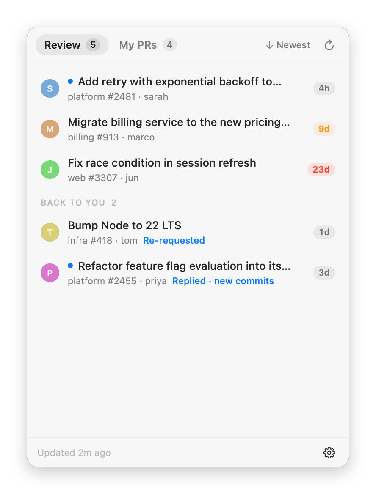
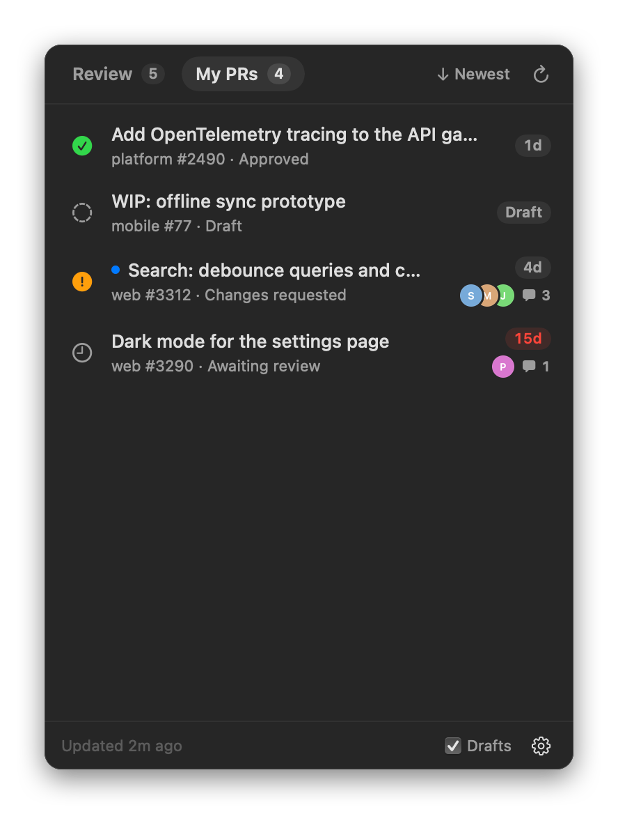

# GitHub Monitor

A tiny, native macOS menu bar app that tells you which pull requests need you: reviews to do, reviews that came back, and unanswered comments on your own PRs.

<p align="center">
  
  
</p>

- **Native and small.** Swift + AppKit/SwiftUI with no dependencies. The bundle is about 650 KB and uses about 35 MB of memory.
- **One request per refresh.** A single GraphQL query fetches everything.
- **No setup.** It reuses your `gh` CLI login.

## Features

**Review tab**: open, non-draft PRs where you're a requested reviewer or an assignee.

| Section | When a PR shows up |
|---|---|
| **Needs your review** | You haven't submitted a review yet. |
| **Back to you** | You were re-requested, or everything you said has been answered: replies to your threads, an author reply in the conversation, or new commits after your last activity. |

PRs you've approved, or that are still waiting on the author (you have the last word in a thread), are hidden.

**My PRs tab**: your open PRs. Drafts are optional.
- 💬 **Unanswered comments**: unresolved review threads where someone else spoke last, plus conversation comments and review summaries posted after your last reply. Avatars of up to 3 people who left them are shown next to the count.
- **Review status** icon: approved, changes requested, awaiting review, or draft.

**Everywhere**
- **Age pill**: how long the PR has been open for review, counted from when it was marked *ready*, not from draft creation. It turns orange after 7 days and red after 14.
- **Sort** each tab newest or oldest first (by the age pill) with the button next to Refresh. Newest first by default.
- **Group By** user, organization or repository from the ⚙ menu. Each group shows the user's or owner's avatar, and sorting applies within each group.
- **Red dot** on the menu bar icon when something new arrives. New rows get a blue dot.
- **macOS notifications**: one per new event, or a summary for 4 or more. Click one to open the PR.
- **Background refresh** every 2–30 minutes, and again when the Mac wakes.
- **Bots are ignored.** So are your own unsubmitted (pending) review comments.
- **Clicking a row** opens the PR in your default browser. Right-click a row to copy its link.

## Install

### Download

1. Download `GitHubMonitor-<version>.zip` from the [latest release](https://github.com/dzhiganov/github-monitor/releases/latest). It's a universal build for Apple Silicon and Intel, macOS 14+.
2. Unzip it and move **GitHub Monitor.app** to `/Applications`.
3. The app isn't notarized by Apple, so macOS blocks it the first time. Clear the quarantine flag once:
   ```sh
   xattr -dr com.apple.quarantine "/Applications/GitHub Monitor.app"
   ```
   Or try to open it once, then go to System Settings → Privacy & Security and click **Open Anyway**.
4. Launch it. It lives in the menu bar.

### Build from source

Requirements: macOS 14 (Sonoma) or later, and Xcode or the Xcode Command Line Tools (Swift 5.10+).

```sh
git clone https://github.com/dzhiganov/github-monitor.git
cd github-monitor
./build.sh install    # builds, copies to /Applications, launches
```

### Sign in

- **With the GitHub CLI.** If you use [`gh`](https://cli.github.com), run `gh auth login` once. The app picks up the token automatically.
- **With a personal access token.** Paste a [classic personal access token](https://github.com/settings/tokens/new?scopes=repo,read:org&description=GitHub%20Monitor) with the `repo` and `read:org` scopes into the app. It's stored in your Keychain.

## Use

- **Open it** by clicking the icon in the menu bar, or by launching *GitHub Monitor* again from Spotlight or Finder.
- **Navigate:** click a PR to open it. Press `⌘1` / `⌘2` to switch tabs, `⌘R` to refresh, `Esc` to close and `⌘Q` to quit.
- **Gear menu:**
  - Refresh interval
  - Notifications on/off
  - Send Test Notification
  - Launch at Login
  - Access token
  - Quit

### Troubleshooting

- **The icon isn't in the menu bar.** It's probably hidden by a menu bar manager (Hidden Bar, Bartender, Ice) or behind the notch.
  - Launch the app again and the window opens in the top-right corner.
  - To make the icon permanent, ⌘-drag it into the always-visible part of the menu bar.
- **No notifications.**
  - Check System Settings → Notifications → GitHub Monitor.
  - The app is ad-hoc signed, so macOS may ask for permission again after a rebuild.
- **Some PRs are missing.** Organizations that use SAML SSO need the token authorized for that org. Run `gh auth refresh`, or authorize the PAT under *Configure SSO*.

## Development

```sh
swift build                 # debug build
./build.sh                  # release .app → build/GitHub Monitor.app
./build.sh install          # release build + install to /Applications + launch
./build.sh release          # universal build zipped to build/GitHubMonitor-<version>.zip
./scripts/test.sh           # PR classification tests (offline, synthetic payloads)
./scripts/screenshots.sh    # re-render docs/*.png from mock data
swift scripts/make-icon.swift   # regenerate Resources/AppIcon.icns
```

| File | What's in it |
|---|---|
| `Sources/GitHubMonitor/GitHub.swift` | GraphQL query, decoding, and the classification rules (`Classifier`) |
| `Sources/GitHubMonitor/Store.swift` | State, polling, seen/notified tracking (per-PR high-water marks), auth flow |
| `Sources/GitHubMonitor/Views.swift` | SwiftUI popover UI |
| `Sources/GitHubMonitor/AppDelegate.swift` | Menu bar item, badge dot, popover or fallback panel |
| `Sources/GitHubMonitor/Notifier.swift` | macOS notifications |
| `Sources/GitHubMonitor/Auth.swift` | Keychain + `gh auth token` fallback |

### Notes

- Each refresh costs about 100 GraphQL rate-limit points, out of the 5,000 per hour that your token shares with `gh`.
- GitHub's API doesn't say when a review thread was resolved. A thread resolved with no reply and no new commits therefore doesn't count as "answered".

## License

[MIT](LICENSE)
